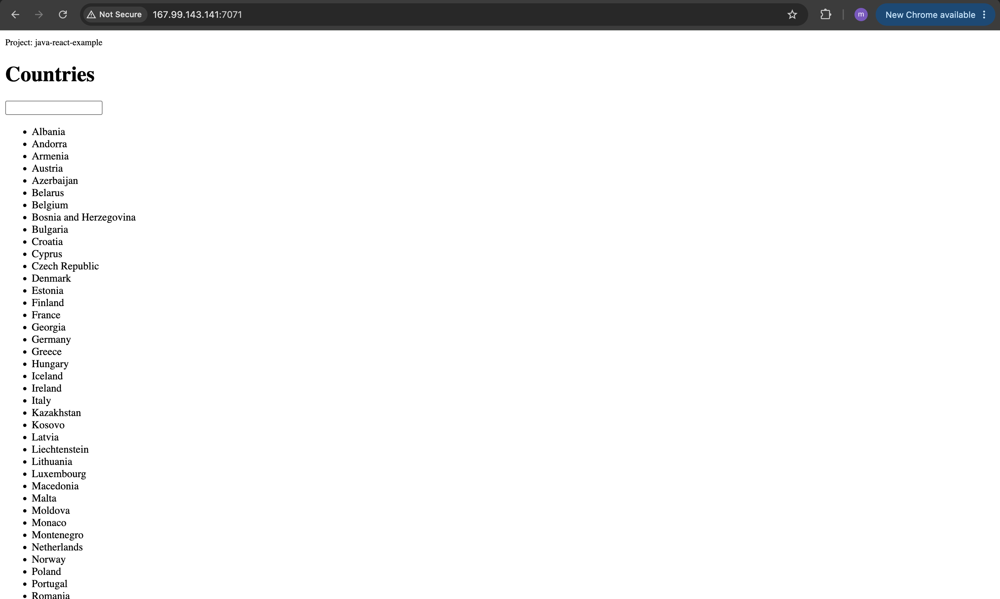

# Cloud & Infrastructure as Service Basics with DigitalOcean

IaaS stands for Infrastructure as a Service. It provisions virtualized compute, storage, and networking resources on-demand over the internet, abstracting away physical hardware management.

## Demo Project

Create server and deploy application on DigitalOcean

## Technologies used

DigitalOcean, Linux, Java, Gradle

## Project Description

- Setup and configure a server on DigitalOcean
- Create and configure a new Linux user on the Droplet (Security best practice)
- Deploy and run a Java Gradle application on Droplet

## Implementation

### Generate the Artifact

- Clone the source code repository which contains react & java.
- Install JDK version 17 and gradle version 7.3 or higher.
- build the source code 

```bash
gradle build    # output build/libs/java-react-example.jar
```

### Create Server on DigitalOcean

- Create Ubuntu Droplet on DigitalOcean (choose the appropriate region, cpu, ram, ..etc)
- Add SSH key to connect to the instance. use `ssh-keygen` 

```bash
ssh-keygen                          # generate key pairs
pbcopy < ~/.ssh/id_ed25519.pub      # copy public key to digitalocean
```

- Create firewall & add inbound rules for SSH on port 22 & HTTP on port 7071 where the application listen for requests
- SSH to the instance with the following command

```bash
ssh root@x.x.x.x                    # use the droplet public IP
```

### Run the Application

- Install the dependencies

```bash
apt update 
apt install openjdk-17-jre-headless
```

- Copy the artifact file to the server & run the application

```bash
scp build/libs/java-react-example.jar root@167.99.143.141:/root
java -jar java-react-example.jar
```

- Check the application running process

```bash
ps aux | grep java
apt install net-tools
netstat -lntp       # show the process id running on port 7071
```

- open the browser & navigate to address `x.x.x.x:7071` to browse the interface



### Create New User

- Create an admin user with sudo privilege to manage the server

```bash
adduser admin                   # create the admin user
usermod -aG sudo admin          # grant admin sudo privileges
su - admin                      # signin to the new admin user
vim .ssh/authorized_keys        # copy the SSH public key to this directory to SSH to the server with the newly created admin user
exit
ssh admin@x.x.x.x               # Log in as your new admin user
```

- Create new user to run the application (security best practice)

```bash
# create a restricted, isolated user for your specific application
sudo adduser my-app

# copy the jar file to the server
scp build/libs/java-react-example.jar admin@167.99.143.141:/home/admin/

# Move the JAR file to the my-app folder
sudo mv /home/admin/java-react-example.jar /home/my-app/

# Give total ownership to the application user
sudo chown my-app:my-app /home/my-app/java-react-example.jar

# Lock down permissions (Read/Write for my-app user only)
sudo chmod 600 /home/my-app/java-react-example.jar

# Switch to the application user environment
sudo su - my-app

# Run your JAR file
java -jar java-react-example.jar
```